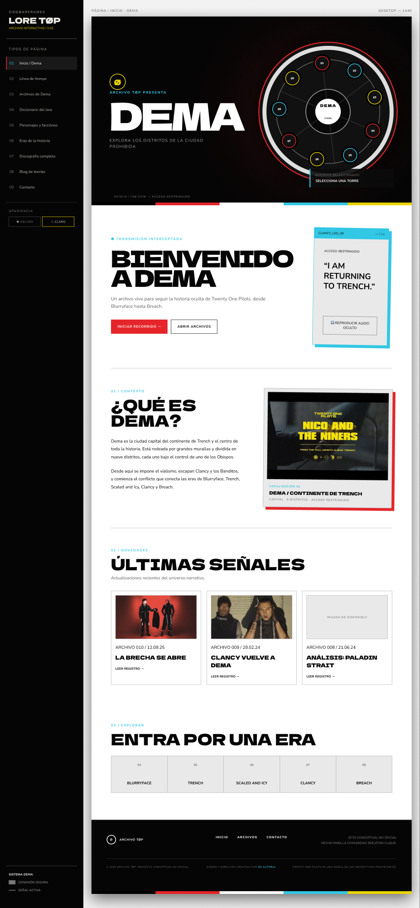
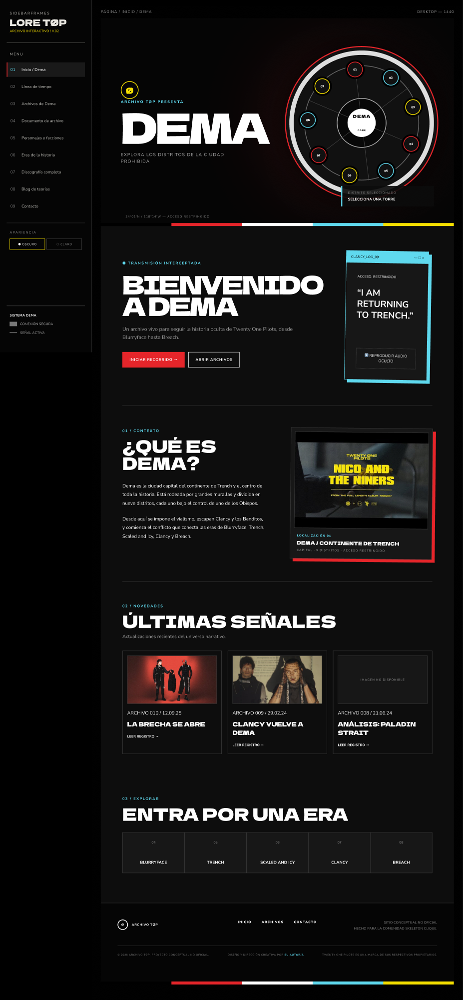
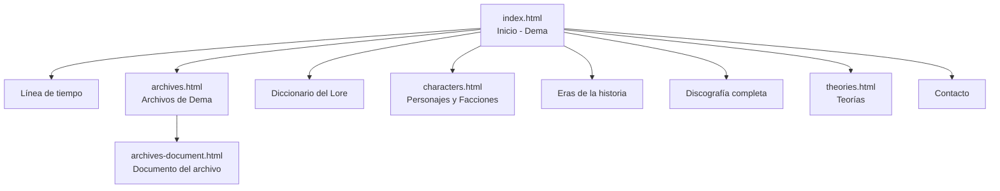
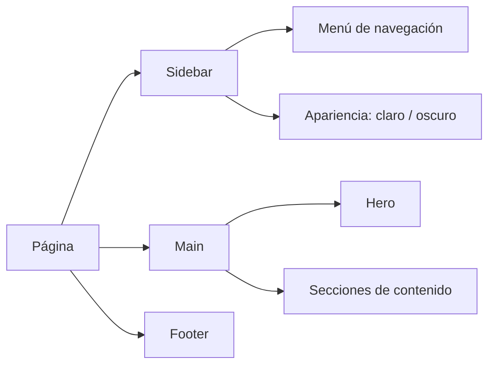

# Lore TØP — Web de apoyo

Web estática (HTML + CSS + JS) sobre el lore de **Dema**, el universo narrativo de Twenty One Pilots.

## Diseño en Figma

🔗 **[Ver el diseño en Figma](https://www.figma.com/design/3HeNfjjdMkVA1IHiB9JfbQ/Lore-TOP-Web-Apoyo-con-IA?node-id=29-4667&t=92XKnrzfw7WoDGx1-1)**

| Modo claro | Modo oscuro |
|---|---|
|  |  |

## Mapa del sitio



## Estructura de cada página



## Estructura del proyecto

```
├── index.html               # Inicio
├── archives.html            # Archivos de Dema
├── archives-document.html   # Documento individual
├── characters.html          # Personajes y facciones
├── theories.html            # Teorías
├── template-structure.html  # Plantilla base
├── css/                     # Un CSS por página
├── js/                      # Scripts
└── docs/                    # Capturas del diseño
```

## Cómo verlo

Abre `index.html` en el navegador. No necesita instalación.
